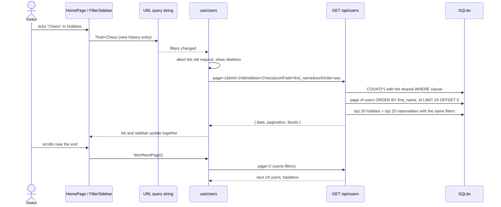
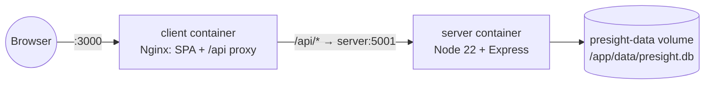
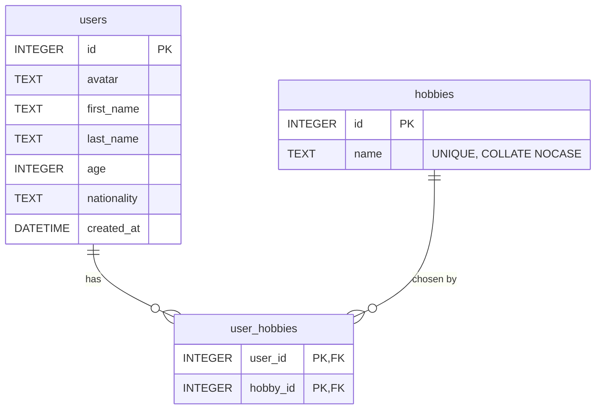

# Presight User Directory — Architecture

A React client talks to a Node.js (Express) API over HTTP. The API is the only
thing that touches the SQLite database, which is the source of truth for users
and hobbies. Each box links to its source file.

## Component diagram

```mermaid
flowchart TD

  subgraph group_client["Directory client (React 19 + Vite)"]
    node_app["Client app<br/>[App.tsx]"]
    node_router["Routes<br/>[router/index.tsx]"]
    node_home["Directory page<br/>[HomePage.tsx]"]
    node_urlstate["URL filters<br/>[useUrlFilters.ts]"]
    node_params["Parse / serialize URL<br/>[filterParams.ts]"]
    node_userhook["User data hook<br/>[useUsers.ts]"]
    node_api_client["API client<br/>[users.api.ts]"]
    node_header["Header + total<br/>[AppHeader.tsx]"]
    node_search["Name search<br/>[SearchBar.tsx]"]
    node_sorting["Sort controls<br/>[SortControls.tsx]"]
    node_filters["Facet sidebar<br/>[FilterSidebar.tsx]"]
    node_facetgroup["Top 20 list<br/>[FacetGroup.tsx]"]
    node_active["Active filter chips<br/>[ActiveFilters.tsx]"]
    node_drawer["Mobile filter drawer<br/>[MobileFilterDrawer.tsx]"]
    node_userlist["Virtual user list<br/>[UserList.tsx]"]
    node_usercard["User card<br/>[UserCard.tsx]"]
    node_hobbies["2 hobbies + n<br/>[HobbyChips.tsx]"]
    node_skeleton["Loading state<br/>[LoadingSkeleton.tsx]"]
    node_states["Empty state<br/>[EmptyState.tsx]"]
    node_errorstate["Error state<br/>[ErrorState.tsx]"]
  end

  subgraph group_api["User API (Express 5)"]
    node_server["API server<br/>[index.ts]"]
    node_appfactory["App + middleware<br/>[app.ts]"]
    node_routes["User routes<br/>[userRoutes.ts]"]
    node_controller["User controller<br/>[user.controller.ts]"]
    node_validation["Query validation<br/>[userQuery.validation.ts]"]
    node_service["User service<br/>[userService.ts]"]
    node_repository["User repository<br/>[user.repository.ts]"]
    node_errors["Error handler<br/>[errorHandler.ts]"]
  end

  subgraph group_data["SQLite data"]
    node_database["SQLite connection<br/>[database.ts]"]
    node_schema["Database schema<br/>[schema.sql]"]
    node_seed["Data seeding<br/>[seed.ts]"]
    node_seeddata["Seed lists<br/>[seedData.ts]"]
  end

  node_visitor(("Directory visitor"))
  node_sqlite[("SQLite database<br/>data/presight.db")]

  node_visitor -->|"opens / shares URL"| node_app
  node_app -->|"routes /"| node_router
  node_router -->|"shows"| node_home
  node_home -->|"reads and updates"| node_urlstate
  node_urlstate -->|"q, nat, hob, sort, order"| node_params
  node_home -->|"loads results"| node_userhook
  node_home -->|"renders"| node_header
  node_home -->|"renders"| node_search
  node_home -->|"renders"| node_sorting
  node_home -->|"renders"| node_filters
  node_home -->|"phones"| node_drawer
  node_drawer -->|"wraps"| node_filters
  node_filters -->|"renders"| node_active
  node_filters -->|"nationalities, hobbies"| node_facetgroup
  node_home -->|"renders"| node_userlist
  node_userlist -->|"renders visible rows"| node_usercard
  node_usercard -->|"renders"| node_hobbies
  node_home -.->|"while page 1 loads"| node_skeleton
  node_home -.->|"no results"| node_states
  node_home -.->|"request failed"| node_errorstate
  node_userhook -->|"requests pages"| node_api_client
  node_api_client -->|"GET /api/users"| node_routes
  node_server -->|"creates"| node_appfactory
  node_appfactory -->|"mounts"| node_routes
  node_routes -->|"dispatches"| node_controller
  node_controller -->|"parses query"| node_validation
  node_controller -->|"requests results"| node_service
  node_service -->|"queries users and facets"| node_repository
  node_controller -.->|"400 / 500"| node_errors
  node_repository -->|"executes SQL"| node_database
  node_database -->|"reads and writes"| node_sqlite
  node_database -->|"initializes from"| node_schema
  node_server -->|"initializes"| node_database
  node_server -->|"seeds if empty"| node_seed
  node_seed -->|"reads lists"| node_seeddata
  node_seed -->|"inserts records"| node_database

  click node_app "client/src/App.tsx"
  click node_router "client/src/router/index.tsx"
  click node_home "client/src/pages/HomePage.tsx"
  click node_urlstate "client/src/hooks/useUrlFilters.ts"
  click node_params "client/src/utils/filterParams.ts"
  click node_userhook "client/src/hooks/useUsers.ts"
  click node_api_client "client/src/api/users.api.ts"
  click node_header "client/src/components/layout/AppHeader.tsx"
  click node_search "client/src/components/toolbar/SearchBar.tsx"
  click node_sorting "client/src/components/toolbar/SortControls.tsx"
  click node_filters "client/src/components/filters/FilterSidebar.tsx"
  click node_facetgroup "client/src/components/filters/FacetGroup.tsx"
  click node_active "client/src/components/filters/ActiveFilters.tsx"
  click node_drawer "client/src/components/filters/MobileFilterDrawer.tsx"
  click node_userlist "client/src/components/users/UserList.tsx"
  click node_usercard "client/src/components/users/UserCard.tsx"
  click node_hobbies "client/src/components/users/HobbyChips.tsx"
  click node_skeleton "client/src/components/states/LoadingSkeleton.tsx"
  click node_states "client/src/components/states/EmptyState.tsx"
  click node_errorstate "client/src/components/states/ErrorState.tsx"
  click node_server "server/src/index.ts"
  click node_appfactory "server/src/app.ts"
  click node_routes "server/src/routes/userRoutes.ts"
  click node_controller "server/src/controllers/user.controller.ts"
  click node_validation "server/src/validations/userQuery.validation.ts"
  click node_service "server/src/services/userService.ts"
  click node_repository "server/src/repositories/user.repository.ts"
  click node_errors "server/src/middleware/errorHandler.ts"
  click node_database "server/src/db/database.ts"
  click node_schema "server/src/db/schema.sql"
  click node_seed "server/src/db/seed.ts"
  click node_seeddata "server/src/db/seedData.ts"

  classDef toneBlue fill:#dbeafe,stroke:#2563eb,stroke-width:1.5px,color:#172554
  classDef toneAmber fill:#fef3c7,stroke:#d97706,stroke-width:1.5px,color:#78350f
  classDef toneMint fill:#dcfce7,stroke:#16a34a,stroke-width:1.5px,color:#14532d
  classDef toneIndigo fill:#e0e7ff,stroke:#4f46e5,stroke-width:1.5px,color:#312e81
  class node_app,node_router,node_home,node_urlstate,node_params,node_userhook,node_api_client,node_header,node_search,node_sorting,node_filters,node_facetgroup,node_active,node_drawer,node_userlist,node_usercard,node_hobbies,node_skeleton,node_states,node_errorstate toneBlue
  class node_server,node_appfactory,node_routes,node_controller,node_validation,node_service,node_repository,node_errors,node_sqlite toneAmber
  class node_database,node_schema,node_seed,node_seeddata toneMint
  class node_visitor toneIndigo
```

## Request flow: a filter change

## Deployment (Docker Compose)

## Data model

Hobbies are a separate table joined through `user_hobbies` (not a JSON column),
so "has all of these hobbies" and "top 20 hobbies" are index-backed SQL
(`GROUP BY` / `HAVING COUNT`) instead of parsing text for every row.

## Layer responsibilities

| Layer | File | Job |
|---|---|---|
| Routes | `server/src/routes/userRoutes.ts` | URL → controller wiring only |
| Controller | `server/src/controllers/user.controller.ts` | HTTP in/out |
| Validation | `server/src/validations/userQuery.validation.ts` | Parse and check query params; bad input → 400 |
| Service | `server/src/services/userService.ts` | Pagination maths, assembles the response |
| Repository | `server/src/repositories/user.repository.ts` | All SQL; one shared `WHERE` builder for list, count and facets |
| DB | `server/src/db/*` | Connection, schema, seed |
| URL state | `client/src/hooks/useUrlFilters.ts` | URL is the single source of truth for the view |
| Data | `client/src/hooks/useUsers.ts` | Paging, abort of stale requests, loading/error flags |
| View | `client/src/components/{layout,toolbar,filters,users,states}` | Presentational components, grouped by area |
| Styles | `client/src/index.css` | Tailwind 4 theme + a few named component classes (card, chips, facet rows) |
